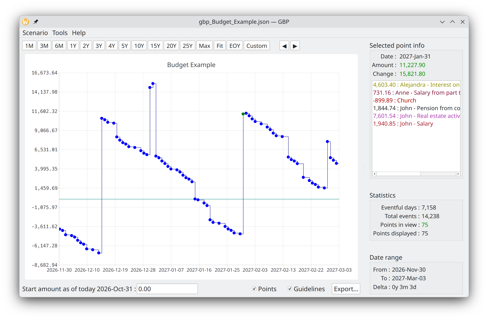
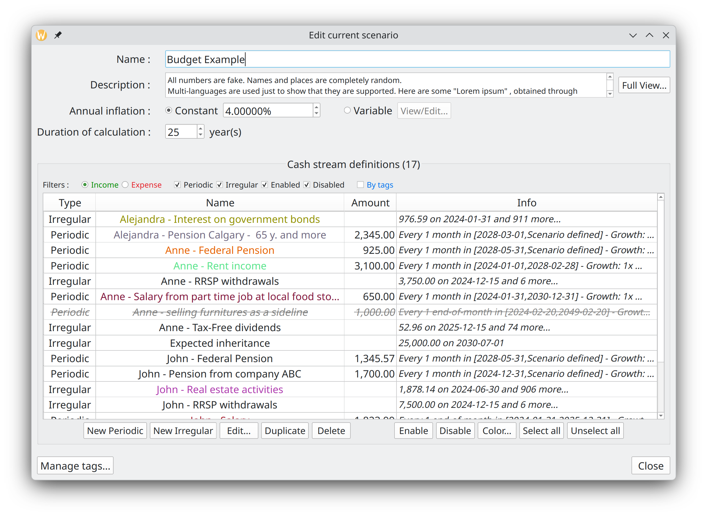
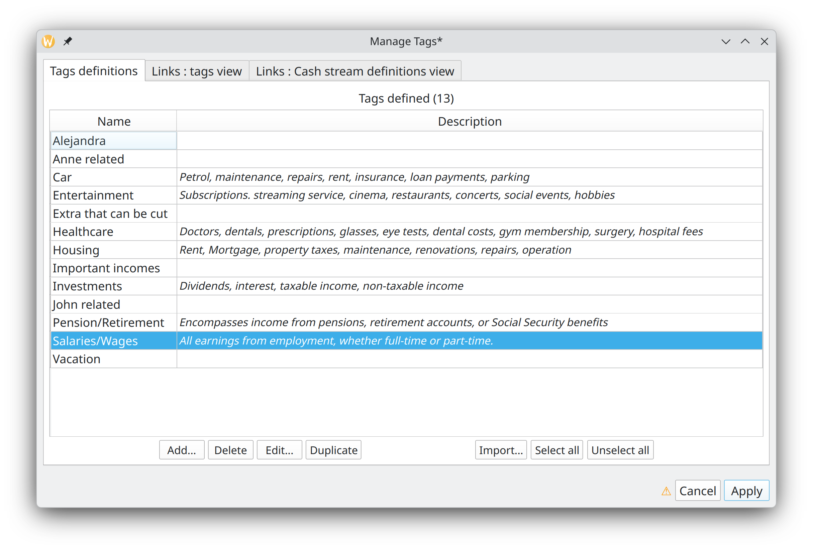
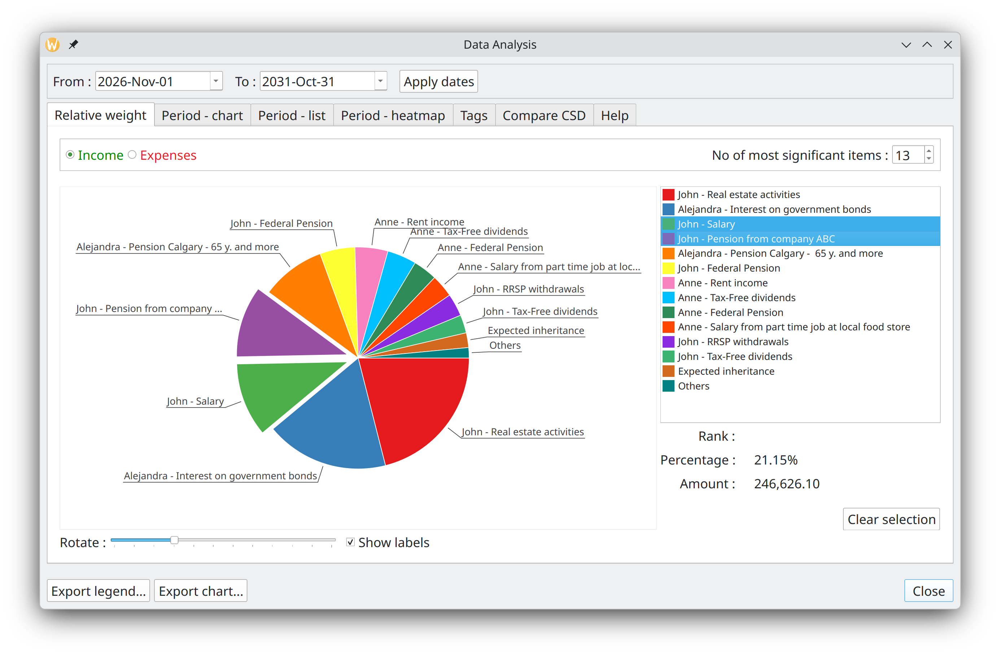
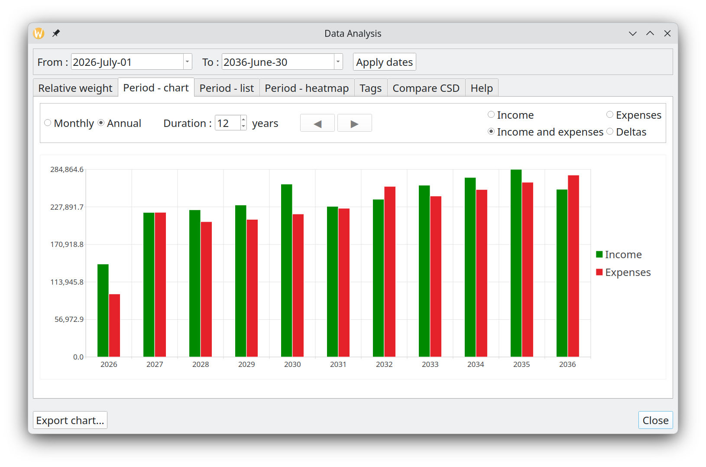
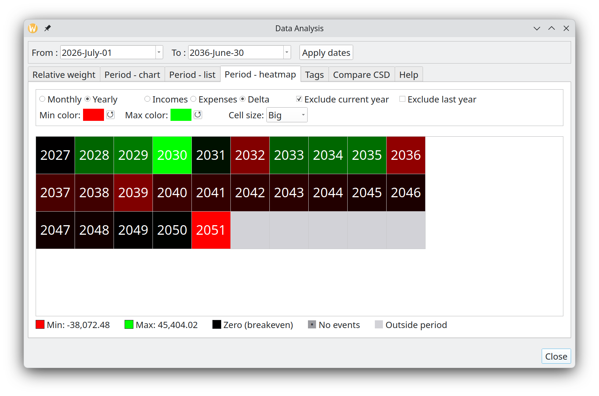

# graphical-budget-planner

## What's new ?

Version **1.9.0**, released on 5 November 2026, brings <u>substantial</u> improvements ! Here are the main changes compared to 1.8.2 (see CHANGELOG for the many other changes and additional details) :

- **Dramatically faster loading and calculations** : GBP now handles very large scenarios with ease, even with daily financial streams over 100 years. Operations that took many seconds (sometimes minutes) now take two seconds at most, most of them almost instantly. This is done in part by limiting the number of points (a.k.a. "markers") displayed to a configurable ceiling (2000 by default).

- **Changes not applied are shown** : in Edit Scenario, the financial stream dialogs, Manage Tags, Options and the description editor, an orange ⚠ appears next to the buttons at the bottom, the window title ends with "\*", and "Close" is replaced by "Cancel" and the button that applies the changes ("Save" in Options).

- **Tag breakdown** : in Analysis, Tags tab, selecting a tag shows the Cash stream definitions contributing to it, as a table and a pie chart.

- **Enhanced color settings** : in Edit Scenario, the colors of Cash stream definitions can now be copied and pasted, including with keyboard shortcuts.

- **New Quick Tutorial** : completely rewritten, in English and French, to be easier to read and to follow, with diagrams of the main windows and a worked example.

- **Two versions for Linux** : the "Embedded manuals version" as before and considered as the default, and a much smaller "Online manuals version" (see Installation) for cases where disk space is critical.

## Screenshots

The Main window



Editing a scenario



Managing tags



Analysis - Relative weight of incomes/expenses



Analysis - Annual Report Chart



Analysis - Heatmap



## Installation

### On Linux

GBP is distributed as an “AppImage” on Linux platform, which is a single-file executable packaging format allowing a program to run on many Linux distributions. There is nothing else to install in most cases. After downloading the most recent AppImage application from https://github.com/redmoon1945/gbp/releases, user has to enable “executable” permission on the file and it is ready to be launched.

###### Two versions : embedded or online manuals

Two AppImages are provided for each version of GBP. They differ only by how the documentation is provided ; GBP works the same way in both :

* `gbp-x.y.z-x86_64.AppImage`, the "Embedded manuals version" : the User Manual, the Quick Tutorial (PDF, English and French) and the Change Log (PDF, English) are included, and opened by the default PDF viewer of the system.
* `gbp-x.y.z-nomanual-x86_64.AppImage`, the "Online manuals version" : use it when disk space is really critical. Much smaller, it does not include these documents. "Help → User Manual", "Help → Quick Tutorial" and "Help → Change log" show the address where the PDF can be downloaded from this repository (directory "doc"), with a button to copy it : paste it in your web browser. GBP itself never accesses the Internet.

In both versions, the Welcome document (PDF) is included and opens at the first start.

###### NixOS case

NixOS does not use the traditional Linux filesystem layout (no `/lib64`, no FHS-style directories) that AppImages expect, so the GBP AppImage will **not** launch directly, even after setting the executable permission. Running it as-is typically fails with an error such as `cannot execute binary file`.

To run the GBP AppImage on NixOS, you have two options :

* **One-off / try it out** : run it through `appimage-run`, without installing anything permanently :

  `nix-shell -p appimage-run --run "appimage-run ./gbp-x.y.z-x86_64.AppImage"`

* **Permanent fix (recommended)** : enable AppImage support system-wide by adding this to your `configuration.nix`, then running `sudo nixos-rebuild switch` :

  ```nix
  programs.appimage = {
    enable = true;
    binfmt = true;
  };
  ```

  Once enabled, AppImages (including GBP's) can be launched directly, e.g. `./gbp-x.y.z-x86_64.AppImage`, or by double-clicking them in a file manager, just like on any other distribution.

Note that GBP's configuration and log files are stored under the standard XDG user directories (`~/.config` and `~/.local/share`), so they behave normally on NixOS regardless of how the AppImage is launched.

###### Omarchy case

On Omarchy (Hyprland), in the "About Graphical Budget Planner" window (Help menu), the "View" button next to "Log file :" opens the `.txt` log file through the system's default handler for the `text/plain` MIME type. On a default Omarchy setup, that handler is `nvim`, a terminal-based editor. Since `nvim` isn't spawned in its own terminal window, it takes over the terminal GBP was launched from instead of opening in a separate window.

This is not a GBP bug, but a consequence of the default MIME association on Omarchy. To fix it, reassign the default `text/plain` handler to a GUI text editor :

```bash
xdg-mime query default text/plain
ls /usr/share/applications/ ~/.local/share/applications/ | grep -i -E 'edit|text|kate|gedit|code'
xdg-mime default <your-editor>.desktop text/plain
```

Replace `<your-editor>.desktop` with the `.desktop` file of any installed GUI editor (e.g. `gnome-text-editor.desktop`, `kate.desktop`, `code.desktop`). Once set, "View" will open the log file in that GUI editor instead of taking over the terminal.

### On Windows®

GBP is distributed as a simple zip file (see https://github.com/redmoon1945/gbp/releases) : unzip it in a folder of your choice and run the gbp.exe application found inside. The zip file includes the User Manual and the Quick Tutorial.

## Supported Platforms and Languages, System Requirements

GBP is intended to be run first and foremost on the Linux Operating System. But since it is built using the Qt cross platform toolkit, a version of GBP for the Windows® Operating System is also provided and fully tested (on Windows® 11 Home Edition only). A version for Mac could easily be created if there is demand for it. A mouse is required to use the software.

GBP is light on RAM usage — typically between 40 and 250 MB even in the most demanding case. It necessitates roughly 55 MB of disk space, about 30 MB for the "Online manuals version" on Linux (not taken into account the scenario files that you will create and GBP log files, which are all very small anyways).

A screen resolution of **1500 x 900** is usually required, but it can be more depending on the application font used. Some guidelines :

* Linux : Noto Sans 10, 12 or 16 : 1500 x 900 ; Noto Sans 24 : 1863 x 1047
* Windows : Segoe UI 9 : 1500 x 900 ; Segoe UI 24 : 1777 x 1035 ; Arial 18 or Comic Sans MS 18 : 1500 x 900

As of November 2026, GBP has been extensively tested on the following platforms :

* **Kubuntu 26.04.1 LTS**, KDE 6.6.6, Wayland, Kernel 7.0.0-42
* **Linux Mint** Debian Edition 7, Cinnamon 6.6.9, X11, Kernel 6.12.113
* **Windows® 11** Home Edition

It has also been tested, but not as extensively, on the following platforms :

* LCOS 1.0, XFCE 4.20, Libre X11, Kernel 7.2.6-lunduke1
* Omarchy 4.04, Wayland Hyprland, Kernel 7.2.3
* MX linux 25.3, XFCE 4.20.1, X11, Kernel 7.2.8
* Fedora 44, KDE Plasma 6.7.5, Wayland, Kernel 7.2.13
* OpenMandriva Lx 6.0, LXQt 2.2.0, kernel 6.14.2
* Ubuntu 24.04.05 LTS, Gnome 46, Kernel 7.0.0-42
* Ubuntu 22.04.05 LTS, Gnome 42.9, X11, Kernel 6.8.0-138
* Ubuntu 22.04.05 LTS, Gnome 42.9, Wayland, Kernel 6.8.0-138

GBP supports English and French languages. By default, English is used, but if the host Operating System is in French (whatever the country), then GBP will switch to French. More languages will hopefully be added in the future, if resources to translate are available.

## License, Disclaimers and Source Code Repository

Graphical Budget Planner (a.k.a graphical-budget-planner or GBP or gbp) is a totally free and open source Qt desktop application intended to ease significantly the process of creating, maintaining and analyzing a personal budget. It does NOT connect to internet whatsoever.

This application and all its source code are licensed under the GNU Affero General Public License version 3 or later (AGPL-3.0-or-later). It's Free Software. See https://www.gnu.org/licenses/#AGPL/

Software repository for GBP can be found at : 
https://github.com/redmoon1945/gbp

Being built with the Qt toolkit, GBP is subject to the Qt terms and conditions : see qt.io/licensing

Credits : 

* Tobias Leupold : code to calculate difference between 2 dates -> see https://nasauber.de/blog/2019/calculating-the-difference-between-two-qdates/

## Usage

See the detailed User Manual to get in depth information about this application : [doc/user_manual-en.pdf](doc/user_manual-en.pdf) (in French : [doc/user_manual-fr.pdf](doc/user_manual-fr.pdf)), and the Quick Tutorial : [doc/quick_tutorial-en.pdf](doc/quick_tutorial-en.pdf) (in French : [doc/quick_tutorial-fr.pdf](doc/quick_tutorial-fr.pdf)).

Graphical Budget Planner (GBP) is an open source Qt desktop application intended to ease significantly the process of creating, maintaining and analyzing a personal budget. It allows the following :

* See graphically the evolution of your cash balance through time, at any given moment in a period covering the next 100 years !
* Easy zooming and/or panning
* Specify painlessly all your forecasted income/expense budget items, with flexibility to define periodic or irregular flow of incomes/expenses.
* Optionally define inflation, either as a constant value or a complex series of changing values.
* Optionally define a custom monthly growth pattern for any income/expense specification , expressed either as a constant value or a complex series of changing values.
* Perform automatically different types of analysis on your data, like relative weight of incomes/expenses over custom period, monthly and yearly reports.
* Optionally convert all amounts to Present Values using a user-defined discount rate in Option Dialog. 
* Your data is not locked in : all scenarios are in open JSON format, and resulting data are exportable in CSV format.
* Fully support UNICODE in all text fields.

GBP is all about CASH BALANCE **FORECASTING** : the key principle adopted in the design of the software is to take into consideration only the **FUTURE** incomes/expenses expected to occur (so the "forecasts"), starting “tomorrow”, “today” being the system date when the application has been launched. **GBP does NOT track past incomes / expenses**...Consequently, this is not the right application if you want know how and when your money has been earned/spent in the past (that is, tracking your incomes/expenses made "before today"). 

## Building GBP

If you want to build yourself the application and not use the provided binaries in the "Releases" folder, see the Building.md